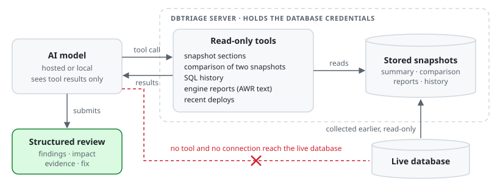
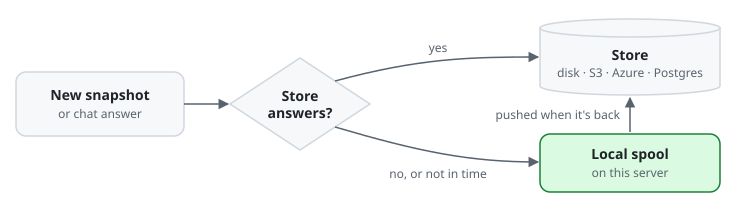

# Second Look

**A second pair of eyes on your databases.** Second Look (the `dbtriage` command) takes a performance snapshot of a
database, compares it with a normal moment, and writes a short review of what changed and what to do about it. It
works with Oracle (AWR, ADDM, ASH), PostgreSQL, MySQL or MariaDB, and SQL Server.

You can run it on a schedule, when an alert fires, or by hand. The review lands wherever your team already
looks: Slack, Teams, email, a ticket, or the built-in web view.

## How it works


1. **Collect.** A read-only monitoring user pulls the numbers: load, top SQL, wait events, sessions, and for
   Oracle the AWR and ADDM reports. Nothing on the database is changed. If you opt in, dbtriage first takes a
   fresh snapshot on the database (an AWR snapshot on Oracle); that takes two switches, one only in `targets.toml`.
2. **Store.** The snapshot is saved, so there is always a history to look back on.
3. **Compare.** The snapshot is compared with a baseline you choose, such as the previous run or the same time
   last week. Simple rules flag the usual suspects: a query that got slower, a new heavy query, a plan change,
   a jump in a wait class, blocking, stale statistics.
4. **Review.** An AI model reads the comparison and writes up the findings, most severe first, each with its
   impact, the evidence and a fix. With no model configured, the rules write the review instead, so you always
   get a result.
5. **Deliver.** The review goes to the channels you picked. Quiet results can stay quiet.

## What the reviewer can see

The model never gets your database credentials and never touches the live database. It works only from the
stored snapshot, through a few read-only tools, and it is told to take every number it quotes from those tools.



You can also **discuss a review** with the model in the web view: ask why a finding matters or what a query is
doing. Those answers use the same read-only tools. If a question needs the live database, the model tells you
what to run, and the discussion never feeds into the next review.

## What a review looks like

This one came from the Oracle lab after a slow query was planted:

> 🔴 **DB review · ora-lab** (oracle, incident)
>
> **3 findings**: 2 high, 1 low
>
> 1. 🔴 **High** · `sql_id d8vkav3yzdfuz`: New heavy SQL takes 100% of SQL time
>    - **Impact:** All SQL time is consumed by this statement, impacting all user queries.
>    - **Evidence:** The statement has executed 2373 times with a total time of 46767.694 ms and a mean time of 19.708 ms per execution.
>    - **Fix:** Investigate the SQL statement for optimization opportunities. Consider re-writing the query or indexing the 'orders' table to reduce the impact of the 'note' and 'amount' predicates.
> 2. 🔴 **High** · `wait class Scheduler`: Scheduler waits increased from 0% to 96% of total wait time
>    - **Evidence:** The top event under 'Scheduler' is 'resmgr:cpu quantum', indicating CPU contention.
> 3. …
>
> **Checked:** compare_snapshots, get_sql_history, get_raw_report, get_recent_changes

## Try it in five minutes

You need Docker and [uv](https://docs.astral.sh/uv/).

```bash
cp .env.example .env                 # lab passwords only; real ones come from your secret store
docker compose up -d                 # Postgres, MySQL, MariaDB and an S3 store to play with
uv sync --extra dev

uv run dbtriage run -t pg-lab --mode scheduled --no-llm         # 1st snapshot: nothing to compare yet
uv run python scripts/load.py postgres --seconds 20
uv run dbtriage run -t pg-lab --mode scheduled --no-llm         # 2nd: becomes the normal moment
uv run python scripts/load.py postgres --seconds 20 --regress    # plant a slow query
uv run dbtriage run -t pg-lab --mode incident --no-llm          # 3rd: the review finds it

uv run dbtriage web --allow-run --allow-edit --allow-chat --schedule   # then open http://127.0.0.1:8081
```

`--no-llm` uses the plain rules. Drop it once a model is configured on the web view's Settings page, or in
`targets.toml`. A local Ollama model works and costs nothing.

## The web view

One page per database with a trend line and its snapshots, one page per snapshot with the review, charts, the
top SQL and a discussion panel, a page to compare any two snapshots, and a search box for databases and SQL ids.
Everything is configurable on the Settings page: databases, schedules, the model, where reviews are posted, and
the look (logo, colours, dark or light). No external scripts or fonts are loaded, so it works on closed networks.

## Where the data lives

Snapshots can live on local disk or an NFS share, in S3 or anything S3-compatible, in Azure Blob Storage, or in
any PostgreSQL-compatible database. The web view's settings can live in that same database, so several servers
share one configuration.

The store is never a single point of failure:



While the store is down, the app keeps running. Pages show what they can under a warning banner, new captures
wait in the spool, settings run on the last good copy, and `/health` reports the outage to your monitoring.

## Learn more

| Page | What's in it |
|---|---|
| [Recipes](recipes/README.md) | ready-to-copy setups: small team, AWS, Azure, Google Cloud, several servers sharing one setup |
| [Configuration](docs/configuration.md) | `targets.toml`, connection strings, opt-in snapshots on the database, picking the baseline, how the comparison works |
| [AI models](docs/models.md) | supported providers, which need no sign-up forms, keeping cost down (token budget, a cheaper or local model for scheduled runs, cloud spending caps) |
| [Storage](docs/storage.md) | every storage option, sharing settings, moving data, outage behaviour in detail |
| [Web view](docs/web.md) | pages, branding, who can see it, the JSON API, discussing a review, scheduling |
| [MCP server](docs/mcp.md) | let Claude Code, Claude Desktop or another MCP client read the stored reviews (off by default) |
| [Running it](docs/operations.md) | all commands, keeping the web view running, triggers from cron, alerts and clouds, delivery channels, safety rules, code layout, testing, what's next |

## Safety in one paragraph

dbtriage only reads, unless you opt in to it taking snapshots on the database (two switches, one of them only in
`targets.toml`). It uses a read-only monitoring user. Point it at an environment variable for the connection
string, kept in your secret store or `.env`, and dbtriage never writes it into its own files; one typed into the web view
is kept in a private settings file and shown masked. Oracle's licensed AWR views are queried only when you say you hold the Diagnostics Pack. Values in SQL text,
such as names or amounts, are masked before anything is stored or shown to the model. Every run leaves a record of
what triggered it and why, what was compared and what was said. It recommends fixes, and people decide whether to apply them.

## Licence

MIT, see [LICENSE](LICENSE).
